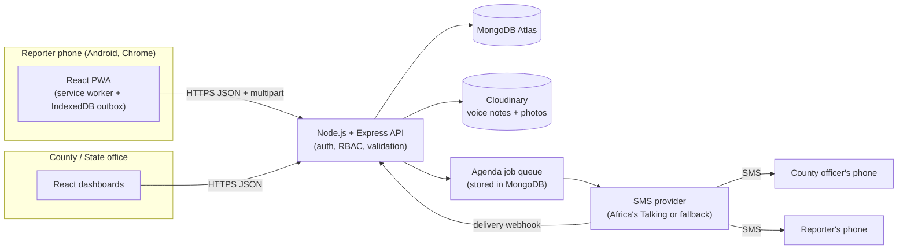
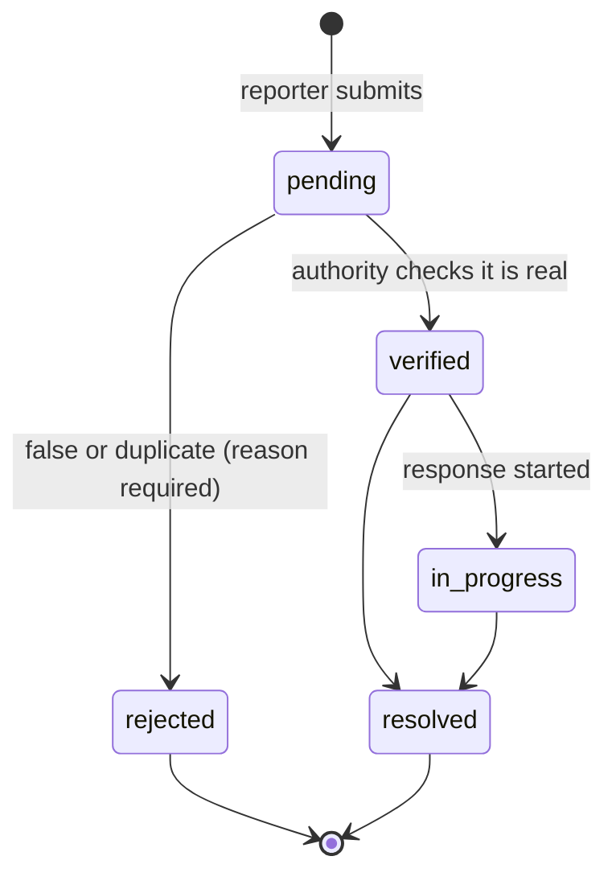

# Gel Abor: Technical Requirements Document (TRD)

Version 1.0, 10 October 2026
Read with: 01_PRD.md, 05_BACKEND_SCHEMA.md

## 1. Architecture overview



### Stack

| Layer | Choice | Why |
|-------|--------|-----|
| Frontend | React 18, Vite, TypeScript | One codebase for reporter PWA and dashboards, small builds with code splitting |
| Styling | Tailwind CSS | Fast to build, design tokens in one config |
| Routing and data | React Router, TanStack Query | Caching and retries handled for us |
| Offline | Workbox service worker, IndexedDB (`idb` library) | App shell offline, report outbox |
| i18n | react-i18next | English and Dinka strings, Nuer later |
| Maps | Leaflet with OpenStreetMap tiles | Free, light |
| Charts | Recharts | Simple charts for dashboards |
| Backend | Node.js 20 LTS, Express, TypeScript | Matches my full-stack skills |
| Validation | Zod (shared between client and server) | One schema for both sides |
| Database | MongoDB Atlas with Mongoose | Flexible documents, geospatial queries |
| Jobs | Agenda (stores jobs in MongoDB) | No Redis needed, so lower cost |
| Media | Cloudinary (authenticated delivery) | Free tier, handles audio and images |
| SMS | Africa's Talking behind a provider interface, with a fallback provider | Swappable if +211 coverage is a problem |
| PDF | pdfkit | Situation reports on the server |
| Logging | pino | Structured logs, no personal data |
| Testing | Vitest, Supertest, mongodb-memory-server, Playwright | Unit, API and end-to-end |
| Hosting | Frontend on Vercel or Netlify, API on Render or Railway (always-on plan for the pilot), MongoDB Atlas | Cheap and simple |

Note: free API tiers that sleep when idle would delay the first SMS by 30 s or more after a quiet period. For the pilot, use an always-on plan so the 60 s SMS target holds.

### Repository layout (monorepo, npm workspaces)

```
gel-abor/
  apps/
    web/        React PWA + dashboards
    api/        Express API + Agenda worker
  packages/
    shared/     Zod schemas, enums, TypeScript types, SMS templates
  docs/         these six documents
```

## 2. Authentication

| Item | Rule |
|------|------|
| Reporter sign-up | Public. Phone (E.164, +211...), 4-digit PIN, county, payam, language. Optional one-time SMS code to confirm the number (recommended, costs one SMS) |
| Authority and admin accounts | Created only by a State Administrator. Password of at least 10 characters |
| Hashing | bcrypt, cost 12 |
| Access token | JWT, 15 minutes, claims: `sub`, `role`, `countyId` (null for state admin) |
| Refresh token | Random 256-bit value in an httpOnly, Secure, SameSite=Strict cookie, valid 7 days, stored hashed, rotated on every use |
| Lockout | 5 wrong PIN or password attempts locks the account for 15 minutes |
| Logout | Revokes the refresh token |

## 3. Role-based access control (server side)

Every protected route runs three middleware steps in order:

1. `authenticate`: verifies the JWT and loads the user. Deactivated users get 401.
2. `requireRole(...roles)`: returns 403 if the role is not allowed.
3. `scopeToCounty`: for `county_authority`, sets `req.scope.countyId` from the token. Every query adds this filter on the server. A `countyId` sent by the client is ignored for this role.

Single-record rule: when a County Authority asks for a report from another county, the API returns 404, not 403, so it does not reveal that the report exists.

### Permission matrix

| Endpoint | Reporter | County Authority | State Admin |
|----------|:--------:|:----------------:|:-----------:|
| POST /reports | Yes | No (403) | No (403) |
| GET /reports/mine | Yes | No | No |
| GET /reports | No | Own county | All (optional `countyId` filter) |
| GET /reports/:id | Own only | Own county | Yes |
| GET /reports/:id/media/:kind | Own only | Own county | Yes |
| PATCH /reports/:id/status | No (403) | Own county | Yes |
| POST /reports/:id/notes | No | Own county | Yes |
| GET /stats/* | No | Own county | Yes |
| POST /sitreps | No | Own county | Yes |
| /users (all methods) | No | No | Yes |
| /counties (write) | No | No | Yes |
| GET /counties | Yes (names and payams only) | Yes | Yes |
| GET /system/health | No | No | Yes |
| GET /audit-logs | No | No | Yes |

An automated test calls every endpoint with each role's token and checks the result against this table. This is how Chapter One's objective "verified through direct API testing" is met.

## 4. API (REST, base path `/api/v1`)

All responses are JSON except media redirects and PDFs. Errors use `{ "error": { "code": "STRING", "message": "text" } }`.

### Auth

| Method and path | Body | Notes |
|-----------------|------|-------|
| POST /auth/register | phone, pin, countyId, payamId, language, consent | Creates a reporter only |
| POST /auth/verify-phone | phone, code | Optional OTP step |
| POST /auth/login | phone, pin or password | Returns access token, sets refresh cookie |
| POST /auth/refresh | (cookie) | Rotates refresh token |
| POST /auth/logout | (cookie) | |
| GET /me | | Current user profile |

### Reports

| Method and path | Notes |
|-----------------|-------|
| POST /reports | multipart/form-data. Fields: `clientId` (UUID v4), `severity`, `description?`, `lat?`, `lng?`, `accuracyM?`, `payamId?`, `bomaId?`, `observedAt`, files `voice?`, `photo?`. Server works out `countyId` from the reporter's profile and the payam. Returns 201, or 200 with the existing report if `clientId` was already used |
| GET /reports/mine | Reporter's reports, newest first, paginated |
| GET /reports | Query: `status`, `severity`, `payamId`, `from`, `to`, `bbox`, `page`, `limit` (max 100) |
| GET /reports/:id | Report plus status history |
| GET /reports/:id/media/voice and /photo | Checks permission, then 302 redirect to a signed Cloudinary URL valid for 10 minutes |
| PATCH /reports/:id/status | Body: `status`, `note` (required, 3 to 500 characters), `reason` (required when rejecting). Validates the transition (section 5), writes a response log, queues an SMS to the reporter |
| POST /reports/:id/notes | Body: `note`, `visibleToReporter` (default false). If true, the reporter sees the note in their report detail |

### Stats and situation reports

| Method and path | Notes |
|-----------------|-------|
| GET /stats/summary?from&to | Counts by status and severity. Average minutes to first verification |
| GET /stats/trends?from&to&interval=day | Reports per day by severity |
| GET /stats/areas?from&to | Reports per payam (county view) or per county (state view) |
| POST /sitreps | Body: `from`, `to`, `countyId?`. Returns `application/pdf` |

### Admin and system

| Method and path | Notes |
|-----------------|-------|
| GET, POST /users; PATCH /users/:id | Create authority or admin accounts, deactivate any account |
| GET /counties; PATCH /counties/:id | Edit payams, bomas, backup alert numbers |
| GET /system/health | See section 10 |
| GET /audit-logs | Filter by actor, action, date |
| POST /webhooks/sms/delivery | Provider delivery reports. Checked with a shared secret |
| GET /healthz | Public, returns `{ ok: true }` only |

## 5. Report status rules



- Allowed transitions are defined once in `packages/shared` and used by both the API and the UI.
- `verifiedAt` and `verifiedBy` are set the first time a report reaches `verified`. `minutesToFirstVerification` = `verifiedAt` minus `receivedAt`.
- Any other transition returns 409 `INVALID_TRANSITION`.

## 6. Offline queue and sync

1. The service worker precaches the app shell so the reporter screens open without network.
2. When the reporter taps Send, the report (with voice and photo blobs) is written to an IndexedDB `outbox` store with a new `clientId` and state `queued`.
3. The app tries to send at once. If that fails, it tries again on the `online` event, when the app opens, and through the Background Sync API where the browser supports it. Backoff: 10 s, 30 s, 2 min, 10 min, then every 10 min.
4. The server has a unique index on `(reporterId, clientId)`, so a repeat send returns the existing report instead of making a duplicate.
5. After a successful send, the outbox entry is deleted and the report appears in "My reports" with its server reference number.
6. `observedAt` (the time on the phone when the report was made) is stored separately from `receivedAt` (server time), so delays caused by poor network can be measured.

## 7. Voice notes and photos

| Item | Rule |
|------|------|
| Recording | MediaRecorder API. Prefer `audio/webm;codecs=opus`, fall back to `audio/mp4` on Safari |
| Length | Up to 60 s. Target bitrate 16 to 24 kbps, so about 120 to 180 KB per minute |
| Photo | Resized on the phone to a maximum of 1280 px on the long side, JPEG quality about 0.7, target 300 KB |
| Server limits | Voice up to 1 MB, photo up to 2 MB. File type checked from the file bytes, not only the extension |
| Storage | Cloudinary with authenticated delivery. The database stores `publicId`, duration, size and type. Media is reached only through the permission-checked endpoint |
| Transcription | Not in the MVP |

## 8. SMS

### When SMS is sent

| Event | To | Template (example, English) |
|-------|----|-----------------------------|
| New report | All active County Authority users in that county, plus the county's backup numbers | `GEL ABOR: New flood report R-1042, Pariak payam, water WAIST deep, 12:40. View: https://gelabor.app/r/1042` |
| Status change | The reporter, in their language | `GEL ABOR: Your report R-1042 was checked by the county. Status: VERIFIED.` |
| Phone confirmation (optional) | The reporter | `GEL ABOR code: 4821` |

### Rules

- Templates live in `packages/shared/sms` with one version per language.
- English text stays in the GSM-7 character set so one message holds 160 characters. Dinka letters such as ɛ, ɔ and ŋ are not in GSM-7, so a Dinka message is sent as UCS-2 with only 70 characters per part. Keep Dinka templates very short, or agree a simplified spelling for SMS with the community.
- Sending runs as an Agenda job `sms.send`. Retries after 1, 5 and 15 minutes. Every attempt is saved in `smsMessages`.
- The 60-second target is measured from `report.receivedAt` to `sms.sentAt` (the moment the provider accepts the message).
- `SmsProvider` interface: `send(to, body) -> { providerMessageId, accepted }` and `parseDeliveryWebhook(req)`. Implementations: `AfricasTalkingProvider`, a fallback provider, and `ConsoleProvider` for local development.
- A daily SMS cap per county (set in config) protects the budget.
- Before building, confirm that the chosen provider delivers to South Sudan networks (+211). This is an open question in the PRD.

## 9. Location

- Geolocation API with a 10 s timeout and `enableHighAccuracy: true`. Save GeoJSON `Point [lng, lat]` and accuracy in metres.
- If GPS fails or is denied, the reporter picks payam and boma from lists stored on the county record.
- `countyId` always comes from the reporter's registered county, not from GPS, so a report can never be sent to the wrong county by a bad GPS reading.
- Map tiles need internet, so maps are on dashboards only. The reporter flow does not need a map.

## 10. System Health page (State Administrator only)

| Check | How |
|-------|-----|
| Database | `ping` time, connection state |
| API | Version, uptime, error count in the last 24 h |
| Job queue | Jobs waiting, jobs failed in the last 24 h, age of the oldest waiting job |
| SMS gateway | Time of last accepted SMS, failures in the last 24 h, account balance if the provider API offers it |
| Media storage | Usage against the plan limit |

Status per check: OK, Warning or Down, with the time it was last checked.

## 11. Security and privacy

- helmet, strict CORS allowlist, HTTPS only.
- Rate limits: login 5 per minute per IP and per phone; report submission 10 per hour per reporter; registration 3 per hour per IP.
- Zod validation on every request body and query.
- No phone numbers, PINs or tokens in logs. Phone numbers in logs are masked (+2119xxxxx123).
- Reporter phone numbers shown only to that county's authorities and the State Administrator.
- Audit log entry for logins, failed logins, status changes, notes, and account and county changes.
- Secrets only in environment variables.
- Backups: Atlas snapshots, or a nightly `mongodump` job if the plan has no snapshots.
- Data retention agreed with the county before the pilot. Default proposal: voice notes and photos deleted after 12 months, reports kept with the reporter's phone number removed.

## 12. Performance budgets

| Item | Budget |
|------|--------|
| Reporter route JavaScript | 200 KB gzipped or less (dashboards loaded separately through code splitting) |
| Report submit (no media) | p95 under 500 ms on the server |
| Dashboard list query | p95 under 800 ms for 1,000 reports |
| Screen size | Works from 360 x 640 |
| Network | Reporter flow tested on "Slow 3G" throttling |

## 13. Testing

| Level | What |
|-------|------|
| Unit | Status transitions, SMS templates and encoding, Zod schemas, county scoping helper |
| API integration | Supertest with mongodb-memory-server. Includes the full permission matrix test (every endpoint, every role) and the idempotent report submission test |
| SMS timing | Script that submits 30 simulated reports and checks `sentAt - receivedAt` is 60 s or less for at least 95% |
| End to end | Playwright on a mobile viewport: register, voice report, offline report that sends after reconnect, authority verifies, reporter sees new status |
| Usability | Timed sessions with at least 15 pilot reporters |
| Accessibility | axe checks in Playwright, manual check of tap targets and contrast |

## 14. Environments and deployment

- Environments: local, staging, production. Staging uses the SMS provider sandbox.
- CI with GitHub Actions: install, lint, type check, test, build. Deploy on merge to `main`.

### Environment variables

```
NODE_ENV, PORT, APP_URL
MONGODB_URI
JWT_ACCESS_SECRET, REFRESH_TOKEN_PEPPER
CORS_ORIGINS
CLOUDINARY_CLOUD_NAME, CLOUDINARY_API_KEY, CLOUDINARY_API_SECRET
SMS_PROVIDER (africastalking | fallback | console)
AT_USERNAME, AT_API_KEY, AT_SENDER_ID
SMS_WEBHOOK_SECRET
SMS_DAILY_CAP_PER_COUNTY
```
