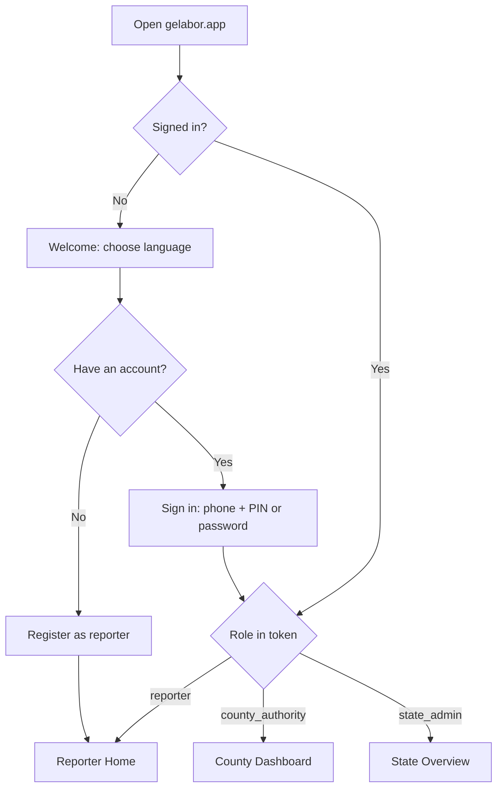
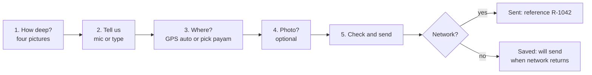
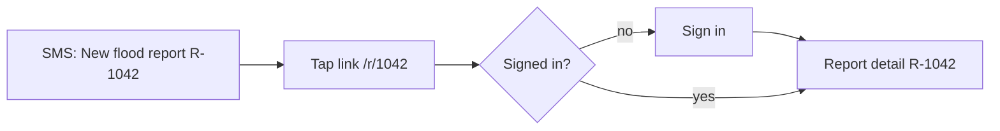
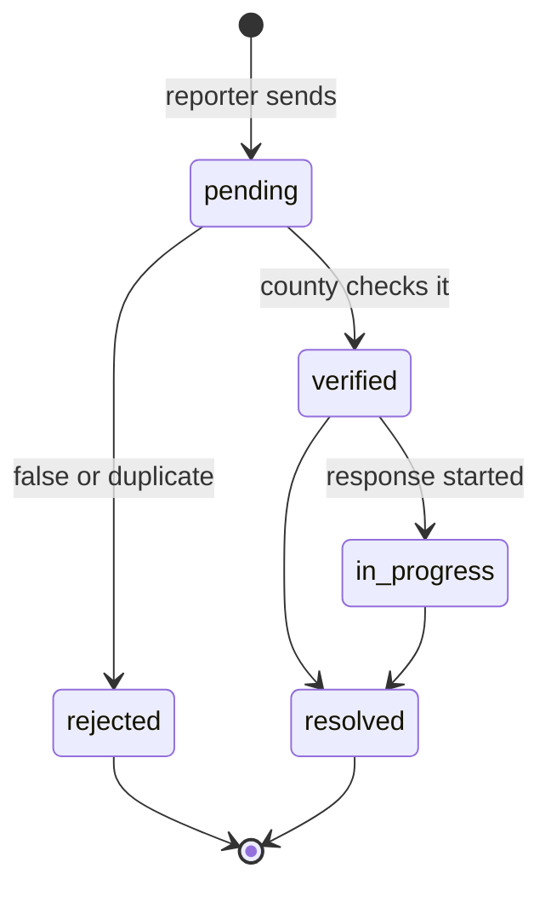
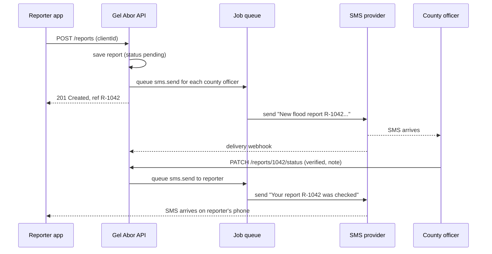
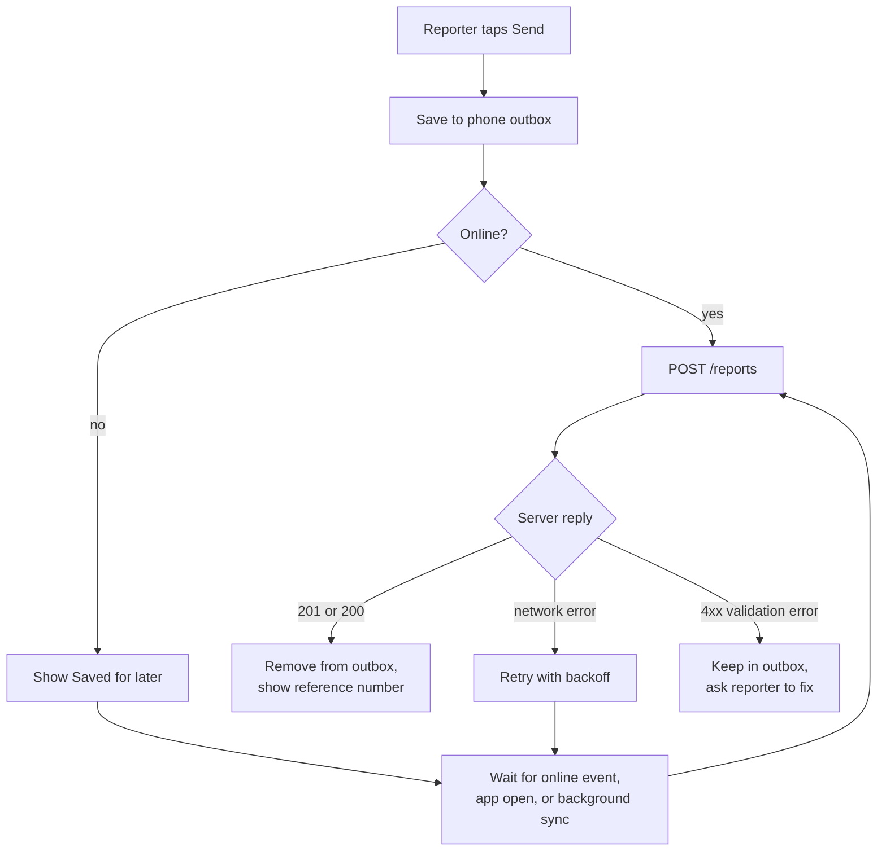

# Gel Abor: App Flow

Version 1.0, 10 October 2026
Read with: 01_PRD.md (stories), 02_TRD.md (endpoints), 04_DESIGN_BRIEF.md (look and feel)

This document lists every screen, what happens on it, and where the user goes next. There are two surfaces:

- **Reporter app**: phone-first, one task per screen, icon-led.
- **Dashboards**: County Authority and State Administrator, built for a laptop or tablet, also usable on a phone.

## 1. Entry and sign-in

Notes:

- Only reporters can register themselves. County Authority and State Administrator accounts are created by a State Administrator, so those users only see "Sign in".
- If the access token expires, the app refreshes it quietly. If the refresh fails, the user goes back to Sign in and keeps any queued reports.

## 2. Reporter app

### 2.1 Registration (first time only)

| Step | Screen | What the user does | Next |
|------|--------|--------------------|------|
| 1 | Language | Taps English or Dinka (Nuer later) | Phone |
| 2 | Phone | Types phone number (+211 prefilled) | PIN |
| 3 | PIN | Chooses a 4-digit PIN, enters it twice | Area |
| 4 | Area | Picks county (pilot county preselected), then payam from a list | Consent |
| 5 | Consent | Hears or reads what data is collected and who sees it, taps "I agree" | Code (optional) |
| 6 | Code | Enters the code sent by SMS (only if phone confirmation is on) | Reporter Home |

### 2.2 Reporter Home

- One very large button: **Report a flood** (water icon).
- A smaller button: **My reports**, with a badge if a status changed.
- A strip at the top if reports are waiting to send: "1 report waiting for network".
- Menu: language, change PIN, sign out, help.

### 2.3 Report a flood (the main flow)

Target: 6 taps or fewer for a voice report, under 60 seconds.

| Step | Screen | Details |
|------|--------|---------|
| 1 | How deep is the water? | Four large picture cards: ankle, knee, waist, severe. Tapping one moves on |
| 2 | Tell us what is happening | Big mic button. Tap to start, tap to stop (60 s max, countdown shown). Play back, re-record or delete. "Type instead" link opens a text box. Needs voice or text to continue |
| 3 | Where are you? | GPS starts as soon as the screen opens. If found: "Location found" with a tick. If not found in 10 s: list of payams, then bomas. Optional field "Near what place?" |
| 4 | Add a photo? | "Take photo" or "Skip". Photo is shrunk on the phone |
| 5 | Check and send | Summary with icons: depth, voice length or text, location, photo thumbnail. Buttons: Send, Back |
| 6a | Sent | Big tick, reference number, "Your county has been told." Button: Home |
| 6b | Saved for later | Clock icon, "No network. We will send it as soon as you are connected." Button: Home |

Rules:

- The flow never blocks on GPS.
- Going Back keeps what was entered.
- If the app is closed during steps 1 to 4, the draft is kept for 24 hours.

### 2.4 My reports

- List of the reporter's reports, newest first: date, depth icon, status chip.
- Waiting reports show at the top with "Waiting to send" and a "Try now" button.
- Tapping a report opens **Report detail**: status timeline (sent, checked by county, help on the way, resolved), with time of each step. Notes from the county show only if the county marks them as visible to the reporter.

## 3. County Authority dashboard

### 3.1 Navigation (dark sidebar)

- Dashboard
- Reports
- Map
- Situation report
- Profile
- Sign out

### 3.2 Arriving from an SMS

### 3.3 Screens

| Screen | Contents | Main actions |
|--------|----------|--------------|
| Dashboard | Stat cards: New (pending), In progress, Resolved this week, Average time to first check. Severity trend chart (last 14 days). Most affected payams. Recent reports list. Mini map | Open a report, go to Reports with a filter |
| Reports | Table: reference, time, payam, depth, input type (voice or text), status, age. Filters: status, depth, payam, date. Sort by newest or by depth | Open report |
| Map | All reports in the county as pins coloured by depth, clustered. Filter panel | Click pin to open report |
| Report detail | Voice note player, text, photo, map pin with accuracy circle, payam and boma, reporter phone (call button), time observed and time received, status timeline with notes | Verify, Reject (reason required), Mark in progress, Resolve, Add note. Each action opens a short note box and asks to confirm |
| Situation report | Date range picker, preview of counts | Download PDF |
| Profile | Name, phone, change password | |

After any status change, a toast says "Reporter will get an SMS", and the timeline updates.

## 4. State Administrator dashboard

### 4.1 Navigation (dark sidebar)

- State overview
- Counties
- Reports (all counties)
- Users
- System health
- Audit log
- Profile
- Sign out

### 4.2 Screens

| Screen | Contents | Main actions |
|--------|----------|--------------|
| State overview | Stat cards for all of Jonglei. Table of the nine counties: new, in progress, resolved, average time to first check. Map of Jonglei with counts per county. Trend chart | Open a county |
| County view | The same dashboard a County Authority sees, for the chosen county | All County Authority actions |
| Reports (all) | Same table as the county view, plus a county filter | Open report |
| Users | Table of users with role, county, status, last sign-in. Filters by role and county | Create authority or admin account, deactivate, reset password |
| Counties | List of nine counties. Each opens payams and bomas, and backup alert phone numbers | Add or edit payams and bomas, edit backup numbers |
| System health | Cards for Database, API, Job queue, SMS gateway, Media storage, each OK, Warning or Down, with details | Refresh, open failed SMS list |
| Audit log | Time, who, action, target. Filters | Export CSV |

The State Administrator never sees a "Report a flood" button. The API blocks report submission for this role as well.

## 5. Report lifecycle

Words shown to reporters (plain language):

| Status | Reporter sees |
|--------|---------------|
| pending | Sent, waiting for the county |
| verified | Checked by the county |
| in_progress | Help is being organised |
| resolved | Closed by the county |
| rejected | Not confirmed by the county (with reason) |

## 6. SMS sequence

## 7. Offline flow

## 8. Errors and empty states

| Situation | What the user sees |
|-----------|--------------------|
| Wrong PIN | "Wrong PIN. 4 tries left." After 5 tries: "Locked for 15 minutes." |
| Microphone permission denied | Picture of how to allow the mic, plus "Type instead" |
| GPS denied or slow | Moves to the payam list without an error |
| Photo too big after shrinking | "Photo too big, try again or skip" |
| No reports yet (reporter) | Picture and "You have not sent any reports." |
| No reports yet (county) | "No reports in your county for this period." |
| County user opens another county's report link | "Report not found" (the API returns 404) |
| Session expired | Back to Sign in, queued reports kept |
| SMS failed after 3 tries | Shows on System Health and in the report timeline as "SMS to officer failed" |

## 9. Screen inventory (for design and build)

Reporter: Welcome/Language, Register (Phone, PIN, Area, Consent, Code), Sign in, Home, Report steps 1 to 5, Sent, Saved for later, My reports, Report detail, Settings.

County Authority: Sign in, Dashboard, Reports, Map, Report detail, Situation report, Profile.

State Administrator: State overview, County view, Reports (all), Users, Create user, Counties, County detail, System health, Audit log, Profile.

Shared: 404, offline banner, toast messages, confirm dialog.
