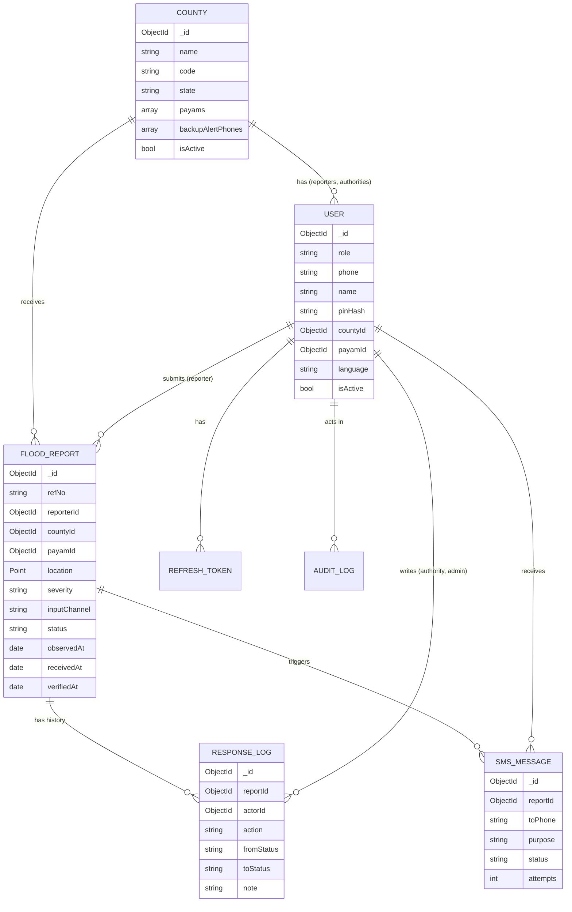

# Gel Abor: Backend Schema

Version 1.0, 10 October 2026
Database: MongoDB (Atlas) with Mongoose
Read with: 02_TRD.md (API and rules)

## 1. Collections at a glance

| Collection | What it holds |
|------------|---------------|
| `counties` | The nine Jonglei counties, with their payams and bomas, and backup alert numbers |
| `users` | All accounts: reporters, county authorities, state administrators |
| `floodReports` | Every flood report |
| `responseLogs` | Status changes and notes on reports (the history) |
| `smsMessages` | Every SMS sent or attempted |
| `refreshTokens` | Hashed refresh tokens for sign-in sessions |
| `auditLogs` | Who did what and when |
| `counters` | Running numbers for report references (R-1042) |
| `agendaJobs` | Managed by Agenda (job queue). Do not edit by hand |

## 2. Entity relationships



## 3. Shared enums (`packages/shared/src/enums.ts`)

```ts
export const ROLES = ['reporter', 'county_authority', 'state_admin'] as const;

export const SEVERITIES = ['ankle', 'knee', 'waist', 'severe'] as const;

export const REPORT_STATUSES = ['pending', 'verified', 'rejected', 'in_progress', 'resolved'] as const;

export const INPUT_CHANNELS = ['text', 'voice', 'both'] as const;

export const LOCATION_SOURCES = ['gps', 'manual'] as const;

// ISO 639-3 codes: English, Dinka, Nuer
export const LANGUAGES = ['eng', 'din', 'nus'] as const;

export const SMS_PURPOSES = ['new_report_alert', 'status_update', 'phone_code'] as const;

export const SMS_STATUSES = ['queued', 'sent', 'delivered', 'failed'] as const;

// Allowed status changes. Used by the API and the UI.
export const STATUS_TRANSITIONS: Record<string, string[]> = {
  pending: ['verified', 'rejected'],
  verified: ['in_progress', 'resolved'],
  in_progress: ['resolved'],
  rejected: [],
  resolved: [],
};
```

## 4. Collections in detail

### 4.1 `counties`

| Field | Type | Rules |
|-------|------|-------|
| `_id` | ObjectId | |
| `name` | string | Unique. One of the nine counties (seed list in section 6) |
| `code` | string | Unique, 3 to 4 capital letters, for example `BOR` |
| `state` | string | Always `"Jonglei"` in this phase |
| `payams` | array of `{ _id, name, bomas: [{ _id, name }] }` | Filled from county records or OCHA HDX data, checked with the county |
| `centroid` | GeoJSON Point | For map centring |
| `backupAlertPhones` | string[] | Extra numbers that get new-report SMS, E.164 |
| `isActive` | boolean | Only the pilot county is active at first |
| `createdAt`, `updatedAt` | date | Mongoose timestamps |

Indexes: `{ name: 1 }` unique, `{ code: 1 }` unique.

### 4.2 `users`

| Field | Type | Rules |
|-------|------|-------|
| `_id` | ObjectId | |
| `role` | enum ROLES | Required |
| `phone` | string | Required, unique, E.164 (`+211...`) |
| `name` | string | Optional for reporters, required for other roles |
| `pinHash` | string | Reporters only. bcrypt of the 4-digit PIN |
| `passwordHash` | string | County authority and state admin only |
| `countyId` | ObjectId ref `counties` | Required for `reporter` and `county_authority`. Must be null for `state_admin` |
| `payamId` | ObjectId | Reporter's home payam (optional for others) |
| `language` | enum LANGUAGES | Default `eng` |
| `phoneVerifiedAt` | date | Set after the optional SMS code |
| `consentAt` | date | Required for reporters |
| `isActive` | boolean | Default true. Inactive users cannot sign in |
| `failedLoginCount` | number | Reset on success |
| `lockedUntil` | date | Set after 5 failed attempts |
| `lastLoginAt` | date | |
| `createdBy` | ObjectId ref `users` | Null for self-registered reporters |
| `createdAt`, `updatedAt` | date | |

Indexes: `{ phone: 1 }` unique, `{ role: 1, countyId: 1, isActive: 1 }` (for finding county officers to alert).

Validation rule (pre-save): if `role` is `county_authority` or `reporter`, `countyId` must be set; if `role` is `state_admin`, `countyId` must be null.

### 4.3 `floodReports`

| Field | Type | Rules |
|-------|------|-------|
| `_id` | ObjectId | |
| `refNo` | string | Unique, human reference like `R-1042`, from `counters` |
| `clientId` | string (UUID v4) | Made on the phone. Used to stop duplicates |
| `reporterId` | ObjectId ref `users` | Required. Must be a reporter |
| `countyId` | ObjectId ref `counties` | Required. Copied from the reporter's county on the server |
| `payamId` | ObjectId | Optional (required if no GPS) |
| `bomaId` | ObjectId | Optional |
| `placeDescription` | string | Optional, up to 120 characters ("near Pariak school") |
| `location` | GeoJSON Point `{ type: 'Point', coordinates: [lng, lat] }` | Optional (required if no payam) |
| `locationAccuracyM` | number | From GPS |
| `locationSource` | enum LOCATION_SOURCES | `gps` or `manual` |
| `severity` | enum SEVERITIES | Required |
| `description` | string | Optional, up to 500 characters |
| `voiceNote` | `{ publicId, mimeType, durationSec, sizeBytes }` | Optional |
| `photo` | `{ publicId, mimeType, width, height, sizeBytes }` | Optional |
| `inputChannel` | enum INPUT_CHANNELS | Set by the server: `text`, `voice` or `both` |
| `status` | enum REPORT_STATUSES | Default `pending` |
| `statusUpdatedAt` | date | |
| `verifiedAt` | date | First time status became `verified` |
| `verifiedBy` | ObjectId ref `users` | |
| `resolvedAt` | date | |
| `rejectedReason` | string | Required when status is `rejected` |
| `observedAt` | date | Time on the phone when the report was made |
| `receivedAt` | date | Server time when the report arrived |
| `wasQueuedOffline` | boolean | True if sent from the offline outbox |
| `createdAt`, `updatedAt` | date | |

Rules:
- At least one of `description` or `voiceNote` must be present.
- At least one of `location` or `payamId` must be present.
- `minutesToFirstVerification` is not stored. Compute it as `(verifiedAt - receivedAt) / 60000` in queries.

Indexes:
- `{ reporterId: 1, clientId: 1 }` unique (stops duplicates from offline retries)
- `{ refNo: 1 }` unique
- `{ countyId: 1, status: 1, receivedAt: -1 }` (county lists and filters)
- `{ countyId: 1, receivedAt: -1, severity: 1 }` (charts)
- `{ location: '2dsphere' }`
- `{ reporterId: 1, receivedAt: -1 }` (My reports)

### 4.4 `responseLogs`

| Field | Type | Rules |
|-------|------|-------|
| `_id` | ObjectId | |
| `reportId` | ObjectId ref `floodReports` | Required |
| `countyId` | ObjectId | Copied from the report, so county scoping works on this collection too |
| `actorId` | ObjectId ref `users` | Required |
| `actorRole` | enum ROLES | `county_authority` or `state_admin` |
| `action` | enum `['status_change', 'note']` | |
| `fromStatus` | enum REPORT_STATUSES | For status changes |
| `toStatus` | enum REPORT_STATUSES | For status changes |
| `note` | string | Required, 3 to 500 characters |
| `visibleToReporter` | boolean | Default false. If true, the reporter sees the note in their report detail |
| `createdAt` | date | |

Index: `{ reportId: 1, createdAt: 1 }`.

### 4.5 `smsMessages`

| Field | Type | Rules |
|-------|------|-------|
| `_id` | ObjectId | |
| `reportId` | ObjectId ref `floodReports` | Null for phone codes |
| `toUserId` | ObjectId ref `users` | Null for backup numbers |
| `toPhone` | string | E.164 |
| `purpose` | enum SMS_PURPOSES | |
| `language` | enum LANGUAGES | |
| `body` | string | The exact text sent |
| `encoding` | enum `['GSM7', 'UCS2']` | Worked out before sending |
| `segments` | number | Number of SMS parts (cost) |
| `provider` | string | `africastalking`, fallback name, or `console` |
| `providerMessageId` | string | From the provider |
| `status` | enum SMS_STATUSES | |
| `attempts` | number | Up to 3 |
| `lastError` | string | |
| `queuedAt` | date | |
| `sentAt` | date | When the provider accepted it (used for the 60 s target) |
| `deliveredAt` | date | From the delivery webhook |

Indexes: `{ reportId: 1 }`, `{ status: 1, queuedAt: 1 }`, `{ providerMessageId: 1 }` sparse, `{ toPhone: 1, queuedAt: -1 }`.

### 4.6 `refreshTokens`

| Field | Type | Rules |
|-------|------|-------|
| `userId` | ObjectId | |
| `tokenHash` | string | SHA-256 of the token with a server pepper |
| `expiresAt` | date | TTL index deletes it after expiry |
| `revokedAt` | date | Set on logout or rotation |
| `replacedBy` | ObjectId | Next token in the rotation chain |
| `createdAt` | date | |

Indexes: `{ tokenHash: 1 }` unique, `{ expiresAt: 1 }` TTL (`expireAfterSeconds: 0`).

### 4.7 `auditLogs`

| Field | Type | Rules |
|-------|------|-------|
| `actorId` | ObjectId | Null for failed logins by unknown phones |
| `actorRole` | enum ROLES | |
| `action` | string | For example `auth.login`, `auth.login_failed`, `report.status_change`, `user.create`, `user.deactivate`, `county.update` |
| `targetType` | string | `report`, `user`, `county` |
| `targetId` | ObjectId | |
| `ip` | string | |
| `userAgent` | string | |
| `meta` | object | Small extra details, no PINs or tokens |
| `createdAt` | date | |

Indexes: `{ createdAt: -1 }`, `{ actorId: 1, createdAt: -1 }`, `{ targetType: 1, targetId: 1 }`.

### 4.8 `counters`

`{ _id: 'reportRef', seq: 1041 }`. The next reference uses `findOneAndUpdate` with `$inc`, so two reports at the same moment never get the same number.

## 5. Mongoose models (key examples)

### FloodReport

```ts
import { Schema, model, Types } from 'mongoose';
import { SEVERITIES, REPORT_STATUSES, INPUT_CHANNELS, LOCATION_SOURCES } from '@gel-abor/shared';

const PointSchema = new Schema(
  {
    type: { type: String, enum: ['Point'], required: true },
    coordinates: { type: [Number], required: true }, // [lng, lat]
  },
  { _id: false }
);

const MediaSchema = new Schema(
  {
    publicId: { type: String, required: true },
    mimeType: { type: String, required: true },
    sizeBytes: { type: Number, required: true },
    durationSec: Number,
    width: Number,
    height: Number,
  },
  { _id: false }
);

const FloodReportSchema = new Schema(
  {
    refNo: { type: String, required: true, unique: true },
    clientId: { type: String, required: true },
    reporterId: { type: Types.ObjectId, ref: 'User', required: true },
    countyId: { type: Types.ObjectId, ref: 'County', required: true },
    payamId: Types.ObjectId,
    bomaId: Types.ObjectId,
    placeDescription: { type: String, maxlength: 120 },
    location: PointSchema,
    locationAccuracyM: Number,
    locationSource: { type: String, enum: LOCATION_SOURCES, required: true },
    severity: { type: String, enum: SEVERITIES, required: true },
    description: { type: String, maxlength: 500 },
    voiceNote: MediaSchema,
    photo: MediaSchema,
    inputChannel: { type: String, enum: INPUT_CHANNELS, required: true },
    status: { type: String, enum: REPORT_STATUSES, default: 'pending' },
    statusUpdatedAt: Date,
    verifiedAt: Date,
    verifiedBy: { type: Types.ObjectId, ref: 'User' },
    resolvedAt: Date,
    rejectedReason: String,
    observedAt: { type: Date, required: true },
    receivedAt: { type: Date, default: Date.now },
    wasQueuedOffline: { type: Boolean, default: false },
  },
  { timestamps: true }
);

FloodReportSchema.index({ reporterId: 1, clientId: 1 }, { unique: true });
FloodReportSchema.index({ countyId: 1, status: 1, receivedAt: -1 });
FloodReportSchema.index({ countyId: 1, receivedAt: -1, severity: 1 });
FloodReportSchema.index({ reporterId: 1, receivedAt: -1 });
FloodReportSchema.index({ location: '2dsphere' });

FloodReportSchema.pre('validate', function (next) {
  if (!this.description && !this.voiceNote) {
    return next(new Error('A report needs voice or text'));
  }
  if (!this.location && !this.payamId) {
    return next(new Error('A report needs GPS or a payam'));
  }
  this.inputChannel =
    this.description && this.voiceNote ? 'both' : this.voiceNote ? 'voice' : 'text';
  next();
});

export const FloodReport = model('FloodReport', FloodReportSchema);
```

### User

```ts
import { Schema, model, Types } from 'mongoose';
import { ROLES, LANGUAGES } from '@gel-abor/shared';

const UserSchema = new Schema(
  {
    role: { type: String, enum: ROLES, required: true },
    phone: { type: String, required: true, unique: true, match: /^\+\d{9,15}$/ },
    name: String,
    pinHash: String,
    passwordHash: String,
    countyId: { type: Types.ObjectId, ref: 'County', default: null },
    payamId: Types.ObjectId,
    language: { type: String, enum: LANGUAGES, default: 'eng' },
    phoneVerifiedAt: Date,
    consentAt: Date,
    isActive: { type: Boolean, default: true },
    failedLoginCount: { type: Number, default: 0 },
    lockedUntil: Date,
    lastLoginAt: Date,
    createdBy: { type: Types.ObjectId, ref: 'User', default: null },
  },
  { timestamps: true }
);

UserSchema.index({ role: 1, countyId: 1, isActive: 1 });

UserSchema.pre('validate', function (next) {
  const needsCounty = this.role === 'reporter' || this.role === 'county_authority';
  if (needsCounty && !this.countyId) return next(new Error('countyId is required for this role'));
  if (this.role === 'state_admin' && this.countyId) return next(new Error('state_admin must not have a countyId'));
  if (this.role === 'reporter' && !this.pinHash) return next(new Error('Reporter needs a PIN'));
  if (this.role !== 'reporter' && !this.passwordHash) return next(new Error('Password required'));
  next();
});

// Never send hashes to the client
UserSchema.set('toJSON', {
  transform: (_doc, ret) => {
    delete ret.pinHash;
    delete ret.passwordHash;
    return ret;
  },
});

export const User = model('User', UserSchema);
```

## 6. Seed data

### Counties (Jonglei State, nine counties since Pibor and Pochalla became the Greater Pibor Administrative Area in 2020)

| name | code |
|------|------|
| Akobo | AKB |
| Ayod | AYD |
| Bor South | BOR |
| Canal/Pigi | CNL |
| Duk | DUK |
| Fangak | FNG |
| Nyirol | NYR |
| Twic East | TWE |
| Uror | URR |

Check this list with the county or state office before seeding, and add payams and bomas for the pilot county only.

### First accounts

- One `state_admin` (the developer during the build, handed to a state official at the pilot).
- Test users for each role on staging only. Never seed test users into production.

## 7. Changes from the earlier ERD diagram

The ERD drawn for the proposal needs these updates so it matches this schema:

1. `status` now has five values: pending, verified, rejected, in_progress, resolved (was three).
2. `input_channel` now has `both` as well as `text` and `voice`.
3. Reports now carry `payamId`, `bomaId`, `clientId`, `observedAt`, `receivedAt` and `verifiedAt`.
4. `ResponseLog` stays, and now holds both status changes and notes, with `visibleToReporter`.
5. `SMSNotification` is now `smsMessages`, with encoding, segments and attempts.
6. New supporting collections: `refreshTokens`, `auditLogs`, `counters`.
7. The diagram title should say "Gel Abor", not "Tïït Abor".
