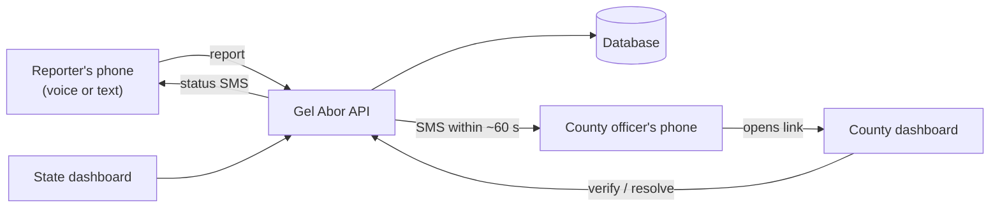
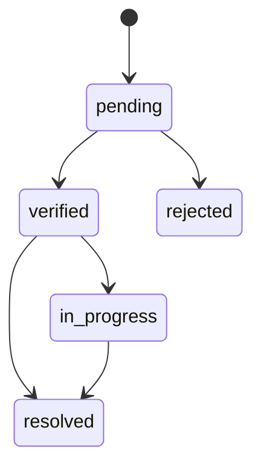

# Gel Abor: Planning Documents

**Gel Abor** ("prevent" in Dinka) is a flood reporting and monitoring system for Jonglei State, South Sudan. A person in a flooded community reports what is happening by recording a voice note or typing a short message. The report goes by SMS to the county authority responsible for that area. County and state officials then check the report, track the response, and see the situation across the state on one dashboard.

This repository holds the **planning documents only**: requirements, design, data model and build plan. The code will live in a separate repository.

> Status: planning (Pre-Capstone, October 2026). Nothing here is final until it has been tested with the pilot community.

---

## Contents

1. [Why this project exists](#1-why-this-project-exists)
2. [Mission](#2-mission)
3. [What Gel Abor does](#3-what-gel-abor-does)
4. [Who uses it](#4-who-uses-it)
5. [How it works](#5-how-it-works)
6. [The documents](#6-the-documents)
7. [Which document to read first](#7-which-document-to-read-first)
8. [Tech stack at a glance](#8-tech-stack-at-a-glance)
9. [Scope](#9-scope)
10. [How success will be measured](#10-how-success-will-be-measured)
11. [Roadmap](#11-roadmap)
12. [Open questions](#12-open-questions)
13. [Viewing the diagrams](#13-viewing-the-diagrams)
14. [Sources](#14-sources)
15. [Author](#15-author)

---

## 1. Why this project exists

Floods in South Sudan keep getting bigger, and Jonglei State is one of the hardest hit.

- By 8 November 2024, floods had affected about **1.4 million people** in South Sudan across **43 counties** and the Abyei Administrative Area. More than **379,000 people** were displaced, and **Jonglei and Northern Bahr el Ghazal** held over half of everyone affected (UN OCHA, 2024).
- Only about **12.1%** of South Sudan's population used the internet in January 2024 (DataReportal, 2024), and only **5.4%** had electricity in 2023 (World Bank, 2023).
- Many adults are not comfortable reading and writing, so tools built only around typed text leave a lot of people out.

Today, most flood information about Jonglei comes from satellite maps and humanitarian situation reports. I could not find any ongoing channel through which someone in a Jonglei community can report a flood directly to their own county authority. Existing tools leave gaps:

| Tool type | Example | What it does well | What it misses for Jonglei |
|-----------|---------|-------------------|----------------------------|
| Crowdsourced crisis maps | Ushahidi (Okolloh, 2009) | Collects many public reports, works over SMS | Doesn't route a report to a named local authority, no voice reporting, usually shut down after one crisis |
| Machine-learning flood forecasting | Google's flood forecasting (Nevo et al., 2022) | Accurate river-level predictions days ahead | Only predicts, can't take a report from the ground, needs river gauges Jonglei mostly doesn't have |

Gel Abor tries to fill that gap.

## 2. Mission

> My mission is to work with flood-affected communities in Jonglei State, especially women, youth, and displaced families, to co-design an SMS and voice-based flood reporting system that gets warnings to local authorities in time to act, using my full-stack development skills.

- **Main Global Challenge (ALU GCGO):** Climate Change (disaster risk reduction)
- **Second GCGO:** Governance

The word "co-design" matters. The first phase of the plan is listening sessions with the community, and the design will change based on what people say.

## 3. What Gel Abor does

- **Report by voice or text.** A big mic button records up to 60 seconds. Typing is optional.
- **Show water depth with pictures.** Four choices: ankle, knee, waist, severe.
- **Location without typing.** GPS is tried first. If it fails, the reporter picks their payam and boma from a list.
- **Works with bad network.** Reports are saved on the phone and sent automatically when the connection comes back, without duplicates.
- **SMS alerts.** The county officer gets an SMS within about a minute of a new report. The reporter gets an SMS when the status changes.
- **County dashboard.** List, map, voice player, photos, status actions, charts, and a downloadable situation report.
- **State dashboard.** All nine Jonglei counties in one view, user management, system health and an audit log.
- **Strict roles.** Permissions are checked on the server, not just hidden in the interface.

## 4. Who uses it

The system has exactly three roles.

| Role | Who | Can | Cannot |
|------|-----|-----|--------|
| **Community Reporter** | People in the pilot county, including women, youth and displaced families, and trusted people like chiefs who report for others | Register with a phone number and PIN, send reports, see their own reports | See other people's reports, change any status |
| **County Authority** | County officials who coordinate flood response | See reports from their own county only, verify, reject, track and resolve them, download situation reports | Submit reports, see other counties |
| **State Administrator (Jonglei)** | A state-level official or the system owner | See all counties, manage users and county data, view system health and audit logs | Submit reports |

## 5. How it works

Report status flow:

## 6. The documents

| # | Document | What it covers | Main readers |
|---|----------|----------------|--------------|
| 01 | [Product Requirements (PRD)](01_PRD.md) | Problem, goals, roles, user stories with acceptance criteria, non-functional requirements, success measures, risks, open questions | Supervisor, panel, anyone new to the project |
| 02 | [Technical Requirements (TRD)](02_TRD.md) | Architecture, stack, authentication, role permissions matrix, full API list, status rules, offline sync, voice notes, SMS rules, security, performance budgets, testing, deployment | Developers |
| 03 | [App Flow](03_APP_FLOW.md) | Every screen for each role, the step-by-step reporting flow, SMS and offline sequences, error and empty states, full screen list | Designers, developers |
| 04 | [Design Brief](04_DESIGN_BRIEF.md) | Design goals, brand and logo, colour tokens, severity and status colours, typography for Dinka letters, icons, layout rules, product wording, accessibility checklist | Designers |
| 05 | [Backend Schema](05_BACKEND_SCHEMA.md) | MongoDB collections, fields, validation rules, indexes, shared enums, Mongoose model examples, seed data for the nine counties | Developers |
| 06 | [Implementation Plan](06_IMPLEMENTATION_PLAN.md) | Phases from co-design to pilot, tasks and "done when" checks, milestones, build risks, definition of done | Supervisor, developer |

## 7. Which document to read first

- **Short on time?** Read this README, then sections 1 to 4 of the [PRD](01_PRD.md).
- **Supervisor or panel member?** [PRD](01_PRD.md), then the [Implementation Plan](06_IMPLEMENTATION_PLAN.md).
- **Designing screens?** [App Flow](03_APP_FLOW.md), then the [Design Brief](04_DESIGN_BRIEF.md).
- **Writing code?** All six, in order. The [TRD](02_TRD.md) and [Backend Schema](05_BACKEND_SCHEMA.md) are the ones you'll come back to most.

## 8. Tech stack at a glance

| Layer | Choice |
|-------|--------|
| Frontend | React, Vite, TypeScript, Tailwind CSS, installable web app (PWA) |
| Offline | Service worker and IndexedDB outbox |
| Backend | Node.js, Express, TypeScript, Zod validation |
| Database | MongoDB Atlas with Mongoose |
| Job queue | Agenda (runs on MongoDB, no Redis needed) |
| Media | Cloudinary for voice notes and photos |
| SMS | Africa's Talking behind a swappable provider interface (coverage for +211 numbers still to be confirmed) |
| Maps and charts | Leaflet with OpenStreetMap, Recharts |
| Testing | Vitest, Supertest, Playwright |

Full reasons for each choice are in the [TRD](02_TRD.md).

## 9. Scope

**In this phase (capstone):**
- Mobile-friendly web app for basic Android phones, working on slow 2G and 3G connections
- One pilot county in Jonglei (to be confirmed with my supervisor)
- 20 to 30 community reporters and 2 to 3 county officials
- English and Dinka

**Not in this phase:**
- Native Android or iOS app
- USSD menus or reporting by inbound SMS from basic phones (planned for Phase 2)
- Flood forecasting
- Rollout to the rest of Jonglei or other states
- Dispatching boats, food or other aid (Gel Abor informs the people who do this, it doesn't replace them)

## 10. How success will be measured

| Measure | Target |
|---------|--------|
| Time to send a report | Under 60 seconds (median), tested with at least 15 pilot reporters |
| SMS to the county officer | Within 60 seconds for at least 95% of 30 test reports |
| Role permissions | 100% of permission tests pass |
| Main pilot measure | Average time from report to first verification, compared with how reports reach the county today |
| Voice versus text | Share of completed reports by each, especially among people with low literacy |
| Community sign-off | Both the county authority and community representatives agree before any wider rollout |

## 11. Roadmap

| Phase | What happens |
|-------|--------------|
| 0. Prepare and co-design | Ethics approval, pilot county, SMS test, listening sessions with the community |
| 1. Setup | Repo, database, county seed data, first deploy |
| 2. Sign-in and roles | Accounts, server-side permission checks with tests |
| 3. Reporting | Voice and text reports, photos, GPS, offline queue |
| 4. SMS | Alerts to county officers, status updates to reporters |
| 5. County dashboard | Reports, map, actions, charts, situation report |
| 6. State dashboard | State overview, users, counties, system health, audit log |
| 7. Hardening | Security, speed, accessibility, usability tests |
| 8. Pilot | 12 weeks in one county (or about 6, see the Implementation Plan) |
| 9. Write-up | Analysis against the four research questions |

## 12. Open questions

These are being worked out with my supervisor and the community:

1. Which Jonglei county will host the pilot?
2. Does the SMS provider deliver to South Sudan (+211) numbers?
3. Should reporting by plain SMS move into the capstone, to match the "SMS and voice-based" mission?
4. Who will translate and check the Dinka text (and Nuer, if needed)?
5. Who owns the data, and for how long is it kept?
6. Does the build start during Pre-Capstone, or does the pilot become shorter?

## 13. Viewing the diagrams

The documents use [Mermaid](https://mermaid.js.org/) diagrams. GitHub draws them automatically when you open a file here. In VS Code, install a Mermaid preview extension to see them.

## 14. Sources

- DataReportal. (2024). *Digital 2024: South Sudan*. https://datareportal.com/reports/digital-2024-south-sudan
- Nevo, S., et al. (2022). Flood forecasting with machine learning models in an operational framework. *Hydrology and Earth System Sciences, 26*(15), 4013-4032. https://doi.org/10.5194/hess-26-4013-2022
- Okolloh, O. (2009). Ushahidi, or 'testimony': Web 2.0 tools for crowdsourcing crisis information. *Participatory Learning and Action, 59*(1), 65-70. https://www.iied.org/g02842
- United Nations Office for the Coordination of Humanitarian Affairs. (2024, November 8). *South Sudan: Floods snapshot (as of 8 November 2024)*. https://reliefweb.int/report/south-sudan/south-sudan-floods-snapshot-8-november-2024
- World Bank. (2023). *Access to electricity (% of population), South Sudan*. https://data.worldbank.org/indicator/EG.ELC.ACCS.ZS?locations=SS

## 15. Author

**Jongkuch Isaac Chol Anyar**
BSE, Full Stack Web Development, African Leadership University
Contact: j.anyar@alustudent.com

I'm from Twic East in Jonglei State, one of the counties this project is meant to serve.

---

© 2026 Jongkuch Isaac Chol Anyar. All rights reserved unless a licence is added later.
